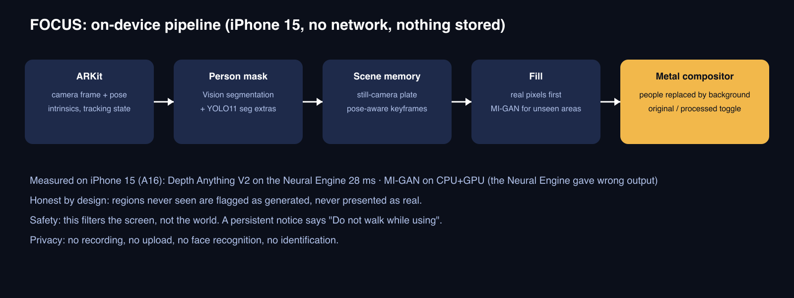
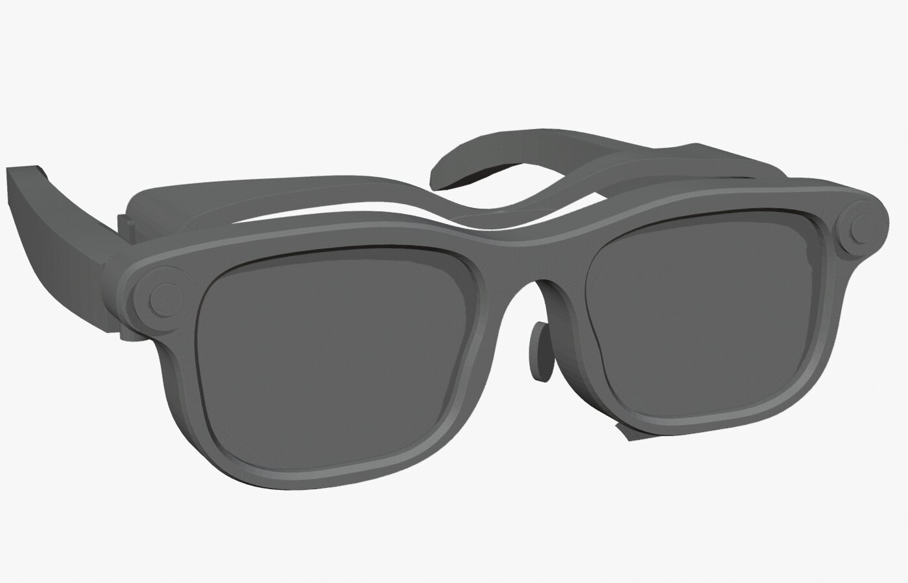
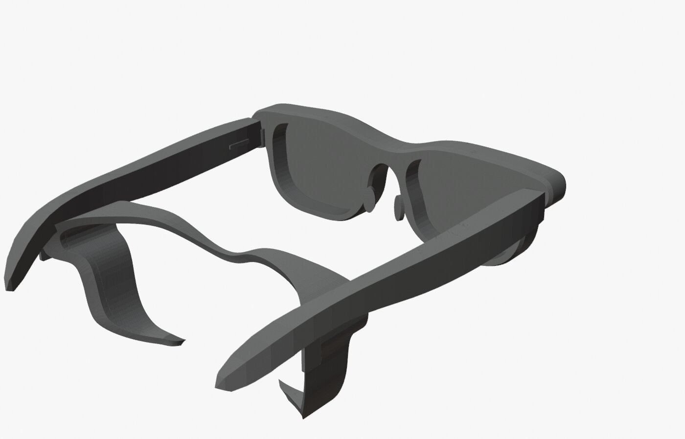

# FOCUS

**Smart spectacles that take the crowd out of your view.** FOCUS is a wearable: glasses that see the room, remove the people in it in real time and show you the space behind them, so you can concentrate on the board, the page or the task.

GDG Ideathon · Ideaverse · BITS Pilani, Dubai Campus

> **What is in this repo.** The product is the spectacles. The hardware is a concept (frame, shield and camera placement in parametric CAD). The **iPhone app is our proof-of-concept test rig**: it runs the same vision engine on a phone so we can build and measure it before the glasses hardware exists.


**Jump to:** [Why](#why-it-matters) · [How it works](#how-it-works) · [Demo](#demo) · [Hardware concept](#hardware-concept-glasses) · [Status](#prototype-status-measured-not-claimed) · [Run it](#run-it) · [Limits](#honest-limits)



## Why it matters


Crowded lecture halls, libraries and labs are visually busy. For students prone to sensory overload, ADHD or social anxiety, constant movement and faces make it hard to hold attention on the task. Today the only options are to leave or to put up with it. FOCUS gives a third option: dim the crowd, keep the room.

> This filters the *screen*, not vision. A removed person is still physically there, so the app shows a persistent "Do not walk while using" notice.

## How it works

| Step | What happens | Tech |
| --- | --- | --- |
| 1. See | Camera frame, camera pose and intrinsics every frame | ARKit |
| 2. Find people | Person mask, plus extra detections for small or distant people | Vision, YOLO11 segmentation (Core ML) |
| 3. Remember the room | A still-camera background plate when the phone is steady; pose-aware keyframes with plane-induced homography when it moves | Metal compute kernels |
| 4. Fill | Real remembered pixels first. Areas never seen are generated once and flagged as generated | MI-GAN 512 (Core ML, CPU+GPU) |
| 5. Show | Feathered composite, with an original / processed toggle | Metal fragment shader |

Design rules we kept: every performance number is measured on the device, never assumed; generated pixels are never presented as real; nothing is recorded, uploaded or identified.

## Demo

- **Physical demo:** we show the vision engine live on an iPhone held at eye level, as close to the glasses experience as we can get it, next to the glasses concept.
- **Videos:** _to be added here._
- **Hosted link:** none. The test rig is a native iOS app and the glasses are a concept.

## The spectacles (the product)

Glasses are the right form because the effect follows your gaze and frees your hands. We designed the frame and a light-blocking shield in parametric CAD (FreeCAD and Blender, from one spec). The frame is wayfarer-style with two front camera apertures and a magnetic light-blocking shield. **It is a concept: the camera module, display and optics are not yet selected or modelled, and nothing here is manufacturing-ready.**




Blueprints: [`hardware/blueprints/`](hardware/blueprints) · spec: [`hardware/specifications/`](hardware/specifications)

## Proof-of-concept test rig (iPhone app)

The app exists to prove the hard part, the real-time removal, on hardware we already own.

### Prototype status (measured, not claimed)

Measured on iPhone 15 (A16), iOS 26.6.1:

| Metric | Result |
| --- | --- |
| Live pipeline, first version (device recordings) | 29-30 FPS, segmentation 12-24 ms, capture-to-display latency 39-67 ms |
| Depth Anything V2 Small, Neural Engine | 28.2 ms median |
| LaMa 512 | 499 ms on GPU, hangs on the Neural Engine, so not used live |
| Still-camera test bench (synthetic clips, 360 frames) | Keyframes engine: person leak 0.39% vs 2.72% for the memory engine on random motion |

Newer work (still-camera plate, MI-GAN fill, keyframe engine) is **compile-checked and bench-tested offline but not yet re-run on the phone.** Details and the full log: [`docs/`](docs).

## Run the test rig

Needs a Mac with Xcode 26, an iPhone with Developer Mode, and a free Apple ID for signing.

```bash
brew install xcodegen
xcodegen generate          # builds Focus.xcodeproj from project.yml
open Focus.xcodeproj       # pick your team, run on a device (the camera is not available in the simulator)
```

Core ML models are not committed (size and licensing). Place `MIGAN512.mlpackage` and `Yolo11sSeg.mlpackage` in `Sources/Models/`; the conversion recipe for MI-GAN is in [`docs/07-still-plan.md`](docs/07-still-plan.md). Note YOLO11 weights are AGPL-3.0, so check the license before redistributing.

## Honest limits

- A person who never moves from the first frame is not revealed on a steady camera; the fill is generated and flagged.
- Moving the phone sideways breaks the rotation-only assumption; the keyframe engine mitigates it for mostly flat surroundings.
- A TV or monitor playing video is frozen to its remembered image.
- Sustained thermal behaviour over 5 minutes is not yet measured.
- The glasses are a concept; the display, optics and on-glasses compute are future work.

## Docs

[01 Feasibility](docs/01-feasibility.md) · [02 Architecture](docs/02-architecture.md) · [03 Plan](docs/03-plan.md) · [04 v2 plan](docs/04-v2-plan.md) · [05 Benchmark](docs/05-p0-benchmark.md) · [06 v3 plan](docs/06-v3-plan.md) · [07 Still-camera layer](docs/07-still-plan.md)
