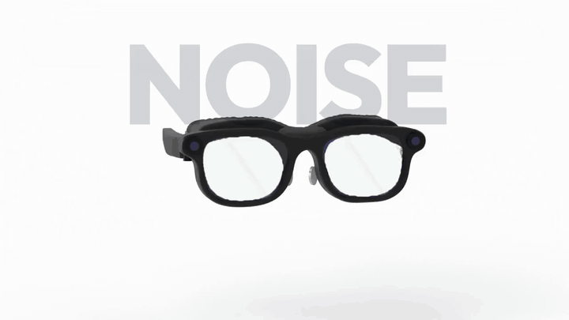
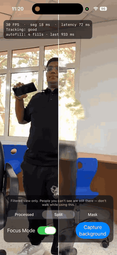
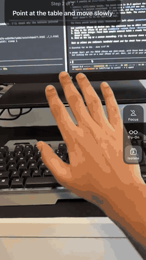
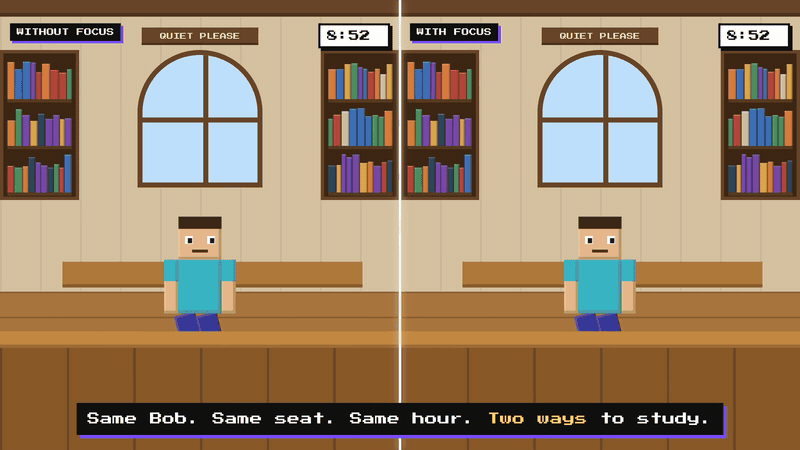
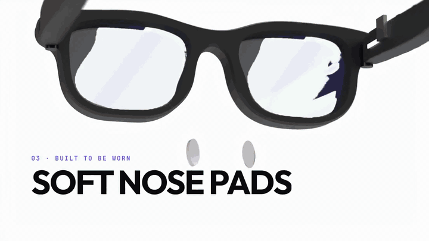
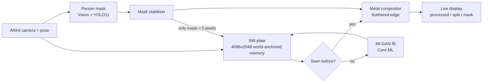
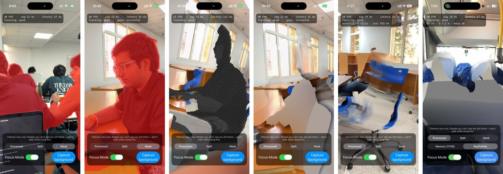
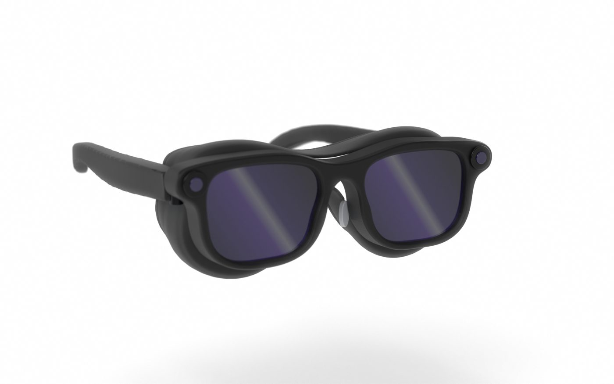
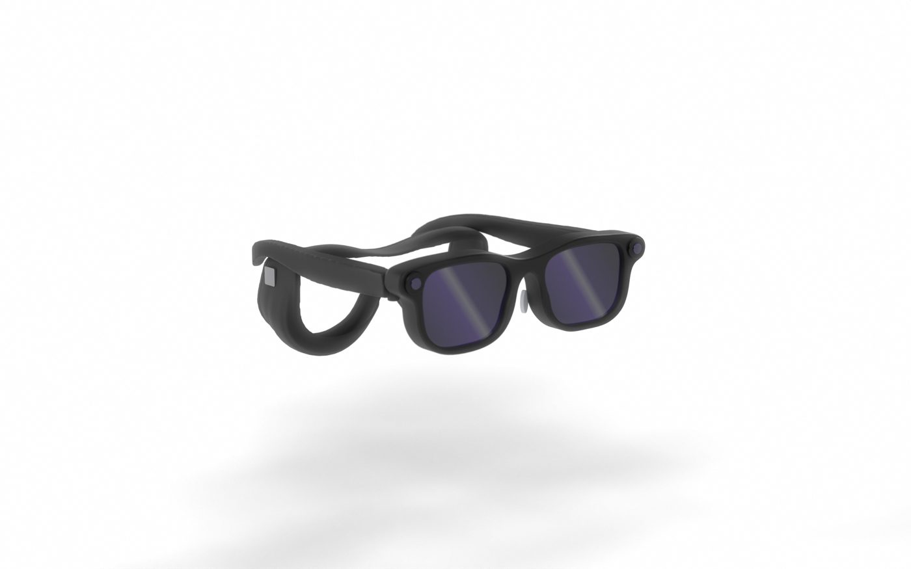
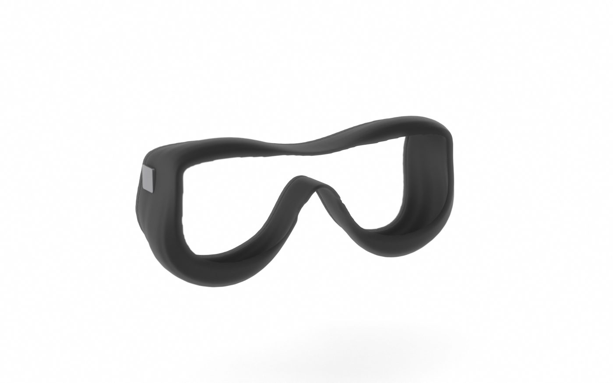

<div align="center">

# FOCUS

### Headphones quiet the noise. **FOCUS quiets the room.**

Smart study glasses that edit people out of your view, so a shared library can feel like a room of your own.

[](#run-the-app)
[](Sources)
[](Sources/Shaders.metal)
[](#privacy)
[](#honest-status)

<a href="docs/media/focus-launch.mp4">
  
</a>

**[Watch the 38 s launch film](docs/media/focus-launch.mp4)** &nbsp;·&nbsp; **[Watch the Bob story](docs/media/focus-bob-story.mp4)** &nbsp;·&nbsp; **[Live pitch deck](https://focus-presenter.vercel.app/deck.html)**

</div>

---

## The problem

Headphones mute **noise**. Nothing mutes **people**: the laugh two tables over, the study group at the whiteboard, someone walking past again and again. In a library, the distraction is often what you *see*.

Be in the room, in your own space. Headphones do it for ears. **FOCUS does it for eyes.**

## What it does

| | |
|---|---|
| **Focus Mode** | Finds every person in the camera feed and replaces them with the room that was behind them. |
| **Isolate** | Keeps your hands, desk, notebook and laptop real, and turns everything past the table into a calm world (moon, mountains, waterfall, forest). |
| **Try-On** | Puts the FOCUS glasses on your face in AR, so you can see the frame before it exists. |

The hardware idea: **two front cameras**, **two near-eye displays** showing a live, cleaned feed (not a window), and a **magnetic shield** that seals the room out. Magnets, hinge pins and soft nose pads make it something you can wear.

## See it running

Real recordings from an iPhone. No mock-ups.

<table>
  <tr>
    <td align="center" width="50%">
      <a href="docs/media/demo-focus.mp4"></a><br>
      <b>Focus Mode</b><br>
      Raw camera on the left, processed on the right, with live FPS, segmentation and latency on screen.
    </td>
    <td align="center" width="50%">
      <a href="docs/media/demo-isolate.mp4"></a><br>
      <b>Isolate</b><br>
      Scan the desk surface (or tap its corners) and everything past the table becomes a calm scene.
    </td>
  </tr>
</table>

*Click a GIF for the full video.*

## The story: same seat, two ways to study

Bob, a college library, 9 a.m. On the left he wears headphones. On the right he wears FOCUS. Same room, same hour.

<a href="docs/media/focus-bob-story.mp4"></a>

## How it works

Four steps, run on every frame:

1. **Spot** every person (Apple Vision person segmentation plus a YOLO11-seg model, with a mask stabiliser to stop edge flicker).
2. **Remember** the wall behind them. The glasses keep a world-anchored memory of the room as people move through it. Only person-free pixels are ever written to memory.
3. **Paint** that memory over the people.
4. **Fill** whatever was never seen, with an on-device inpainting model (MI-GAN).





Everything runs on the phone: Core ML for models, Metal for compositing, ARKit for pose and depth. Full write-ups are in [`docs/`](docs).

## From a red mask to a room that fills itself

Each step is a real screenshot from the iPhone app: find the people, fill the gap, autofill never-seen areas, then new places (a bus).



On our **synthetic benchmark** (7 clips, mean score, lower is better) the engine went from **31.6 to 24.8**, about 21% better. It is a synthetic proxy, not real-world accuracy.

## The glasses

Designed in CAD (FreeCAD) and rendered in Blender. Rev B proved the parts fit; Rev D was rebuilt from a reference sheet into a wayfarer silhouette (0.999 outline overlap); v3 added a rounded foam-seated shield, magnet temples and camera housings.

<table>
  <tr>
    <td></td>
    <td></td>
    <td></td>
  </tr>
  <tr>
    <td align="center">Assembly</td>
    <td align="center">Exploded</td>
    <td align="center">Magnetic shield</td>
  </tr>
</table>

Specifications and assumptions live in [`hardware/specifications`](hardware/specifications). Dimensions from the reference image are provisional, and no camera, display, battery or magnet part is selected yet.

## Privacy

Frames never leave the device. Nothing is recorded or uploaded, there is no account, and no one is identified. The app also reminds you: *people you can't see are still there, so don't walk while using it.*

## Honest status

FOCUS is an **early prototype / concept**.

- The app runs live on an iPhone. The glasses hardware is a CAD design and renders, not a built device.
- Fills still show ghosting in places, as the screenshots above do.
- Latency and weight of the glasses are **not measured**, so we quote no numbers for them.
- The benchmark above is synthetic.

## Run the app

Requirements: Xcode, an ARKit-capable iPhone on iOS 17+, [XcodeGen](https://github.com/yonaskolb/XcodeGen).

```bash
brew install xcodegen
xcodegen            # generates Focus.xcodeproj from project.yml
open Focus.xcodeproj
```

Set your own development team in Xcode, then run on a device. The Core ML models (`LaMa512`, `MIGAN512`) are kept out of git; see `ModelsStash/` and the notes in [`docs/07-still-plan.md`](docs/07-still-plan.md) for how they were converted.

## Repository map

| Path | What is inside |
|---|---|
| [`Sources/`](Sources) | The iOS app: renderer, Metal shaders, still plate, MI-GAN fill, Isolate, Try-On |
| [`Tests/`](Tests) | Unit tests for desk detection, isolation and try-on |
| [`Bench/`](Bench), [`tools/`](tools) | Offline benchmark and synthetic-clip tooling |
| [`docs/`](docs) | Feasibility, architecture, plans, benchmark logs |
| [`hardware/`](hardware) | CAD, Blender scenes, renders, specifications, storyline and launch film sources |

## Team

Built for a hackathon by **Mayank** and **tohraan**.
